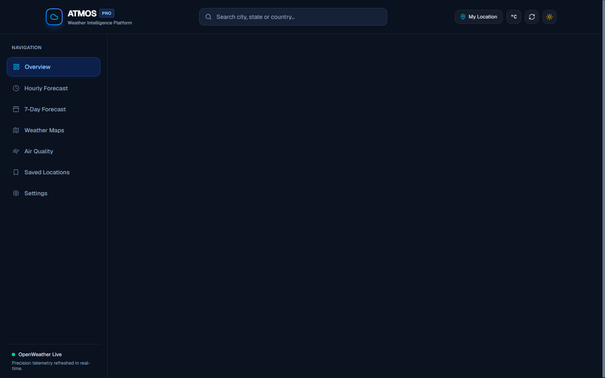
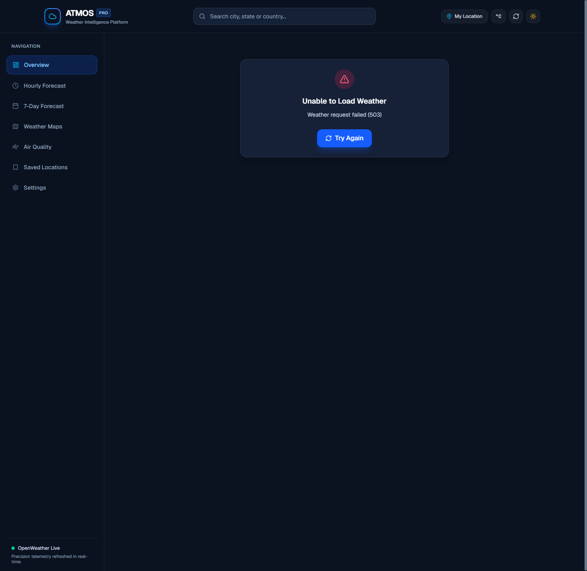
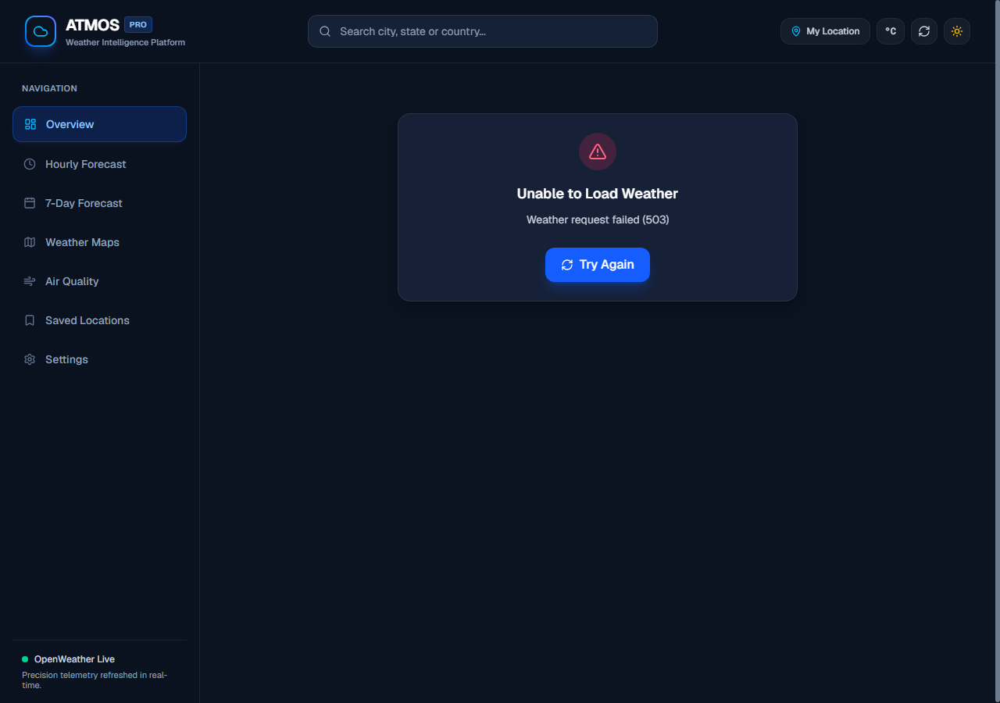

<div align="center">

# ⚡ ATMOS — Weather Intelligence Platform

### *Precision Meteorological Telemetry, Predictive Analytics & Atmospheric GIS*

[](https://nextjs.org/)
[](https://react.dev/)
[](https://www.typescriptlang.org/)
[](https://tailwindcss.com/)
[](LICENSE)
[](https://jestjs.io/)
[](https://atmos-weather-intelligence-ji9p.onrender.com)
[](https://github.com/kshitijhurle95-prog/atmos-weather-intelligence)

<p align="center">
  🌐 <b>Live Production URL:</b> <a href="https://atmos-weather-intelligence-ji9p.onrender.com" target="_blank"><b>https://atmos-weather-intelligence-ji9p.onrender.com</b></a>
</p>

<p align="center">
  <a href="#-executive-summary">Executive Summary</a> •
  <a href="#-visual-showcase">Visual Showcase</a> •
  <a href="#-key-capabilities">Key Capabilities</a> •
  <a href="#-system-architecture">Architecture</a> •
  <a href="#-technology-stack">Tech Stack</a> •
  <a href="#-quickstart--local-setup">Quickstart</a> •
  <a href="#-environment-configuration">Configuration</a> •
  <a href="#-license">License</a>
</p>

---

</div>

## 📌 Executive Summary

Modern consumer weather apps are often cluttered with invasive advertisements, sluggish animations, or imprecise regional estimates. **Atmos** is an engineered weather intelligence platform designed for commuters, athletes, outdoor enthusiasts, and logistics decision-makers who require real-time atmospheric clarity without distractions.

Combining official meteorological observation feeds, high-resolution geospatial radar mapping, deterministic AI-assisted behavioral insights, and micro-climate timeline projections, **Atmos** bridges the gap between high-precision professional weather telemetry and refined consumer software design.

---

## 📸 Visual Showcase

<div align="center">

### 🌌 Primary Command Dashboard & Weather Hero
*Dynamic atmospheric hero banner adapting to real-time sun/moon cycles, thermal status, and live atmospheric condition codes.*



<br/>

### 📊 24-Hour Micro-Timeline & Predictive Analysis
*Horizontally scrollable hourly telemetry, interactive hour inspection, Recharts-powered gradient thermal trends, and precipitation probability distribution.*



<br/>

### 🗺️ GIS Weather Radar & Air Quality Index
*Interactive multi-layer geospatial radar (Cloud Cover, Precipitation Radar, Temperature Isotherms, Wind Vectors) paired with European 5-tier multi-pollutant AQI breakdown.*



</div>

---

## ⚡ Key Capabilities

- **🛰️ Real-Time Observation Grid**: Sub-minute telemetry for Temperature, Feels-Like, Daily High/Low, Barometric Pressure, Relative Humidity, Wind Vector Speed & Direction (with 16-point compass bearings), Cloud Fraction, and Line-of-Sight Visibility.
- **📈 Dual-Chart Temporal Analytics**:
  - *Temperature Area Curve*: Smooth spline visualization with color-graded fills reflecting ambient thermal shifts.
  - *Precipitation Probability Bar Chart*: Hour-by-hour probability modeling from 0% to 100%.
- **📅 Verified Multi-Day Forecast**: 5-day daily forecast synthesized strictly from authenticated meteorological blocks. Features relative visual temperature range bars calibrated to weekly high/low boundaries.
- **🧠 Deterministic Weather Insights**: Algorithmic decision intelligence that correlates thermal trends, barometric changes, and precipitation windows to generate honest, data-backed guidance.
- **🏃 "Plan Your Day" Activity Index**: Pragmatic readiness scoring for running/cardio, walking/commutes, rain gear necessity, and vehicle travel safety.
- **🌍 Global Disambiguated Search & Geolocation**: Instant forward geocoding with debounce mechanisms, keyboard navigation (`ArrowDown`, `ArrowUp`, `Enter`, `Escape`), and HTML5 coordinate triangulation with permission recovery.
- **🌿 Multi-Pollutant Air Quality (AQI)**: Continuous monitoring across 6 critical particulates: PM2.5, PM10, Ground-Level Ozone ($O_3$), Nitrogen Dioxide ($NO_2$), Sulfur Dioxide ($SO_2$), and Carbon Monoxide ($CO$).
- **🗺️ Interactive GIS Mapping**: Dynamic Leaflet integration with CartoDB Voyager cartography and OpenWeather radar overlay toggles.
- **⭐ Localized Persistence**: Save up to 10 favorite cities, designate a launch city, and toggle seamlessly between **Metric** (°C, km/h, mm, hPa) and **Imperial** (°F, mph, in, inHg) standards.

---

## 🏗️ System Architecture

Atmos follows a clean separation of concerns, decoupling server-side provider integrations from client-side visual layers:

```
magical-bell / atmos/
├── assets/
│   └── screenshots/              # High-resolution application UI captures
├── __tests__/
│   ├── integration/
│   │   └── api.test.ts           # Server Route Handler integration tests
│   └── unit/
│       ├── formatting.test.ts    # Unit conversions & string formatting tests
│       ├── normalize.test.ts     # Provider-to-domain normalization tests
│       └── validation.test.ts    # Input boundaries & XSS sanitization tests
├── src/
│   ├── app/
│   │   ├── api/                  # Server-side Route Handlers (Zero Secret Leakage)
│   │   │   ├── air-quality/
│   │   │   │   └── route.ts      # GET /api/air-quality?lat=..&lon=..
│   │   │   ├── forecast/
│   │   │   │   └── route.ts      # GET /api/forecast?lat=..&lon=..
│   │   │   ├── geocoding/
│   │   │   │   └── route.ts      # GET /api/geocoding?q=..&limit=..
│   │   │   └── weather/
│   │   │       └── route.ts      # GET /api/weather?lat=..&lon=..
│   │   ├── globals.css           # Custom CSS variables, dark theme tokens
│   │   ├── layout.tsx            # Root layout, HTML metadata, Provider wrapper
│   │   └── page.tsx              # Primary Atmos weather intelligence dashboard
│   ├── components/
│   │   ├── charts/               # Recharts components (TemperatureChart, PrecipitationChart)
│   │   ├── layout/               # Header, Sidebar, MobileNav
│   │   ├── settings/             # SettingsPanel (Units, Theme, Data Reset)
│   │   ├── ui/                   # Card, Badge, Skeleton, ErrorDisplay
│   │   └── weather/              # WeatherHero, WeatherMetrics, HourlyForecast,
│   │                             # DailyForecast, WeatherInsights, ActivityAdvice,
│   │                             # AirQuality, WeatherMap, WeatherAlerts, SavedLocations
│   ├── context/
│   │   ├── ThemeContext.tsx      # Obsidian Dark & Daylight Light mode context
│   │   └── WeatherContext.tsx    # Centralized client weather state manager
│   ├── hooks/                    # useWeather, useGeocoding, useGeolocation, useFavorites
│   ├── lib/
│   │   ├── weather/
│   │   │   ├── cache.ts          # In-memory TTL cache
│   │   │   ├── normalize.ts      # Provider response transformation layer
│   │   │   ├── openweather.ts    # OpenWeather SDK implementation
│   │   │   ├── provider.ts       # Weather provider abstraction & fetcher
│   │   │   └── types.ts          # Raw provider API payload definitions
│   │   ├── formatting.ts         # Math conversions (°C/°F, kmh/mph, mm/in, hPa/inHg)
│   │   └── validation.ts         # Strict coordinate bounds & search sanitizers
│   └── types/
│       └── weather.ts            # Normalized domain-level TypeScript schemas
├── .env.example                  # Environment configuration template
├── jest.config.js                # Test runner configuration
├── next.config.ts                # Next.js 16 compiler settings
└── package.json                  # Dependencies and execution scripts
```

---

## 💻 Technology Stack

| Domain | Technology | Purpose |
|---|---|---|
| **Core Framework** | [Next.js 16](https://nextjs.org/) | App Router, Server Components, Route Handlers, Turbopack |
| **Frontend Runtime** | [React 19](https://react.dev/) | Concurrent UI rendering and component state lifecycle |
| **Type Safety** | [TypeScript 5](https://www.typescriptlang.org/) | Strict compilation, zero-any policy across domain models |
| **Styling & Theme** | [Tailwind CSS 4](https://tailwindcss.com/) | Responsive glassmorphic styling and tokenized dark themes |
| **Charts & Graphs** | [Recharts](https://recharts.org/) | High-performance SVG thermal and precipitation data charts |
| **Geospatial GIS** | [Leaflet](https://leafletjs.com/) | Interactive pan-zoom spatial weather map with tile layers |
| **Iconography** | [Lucide React](https://lucide.dev/) | Clean, accessible vector icons |
| **Telemetry Provider** | [OpenWeather API](https://openweathermap.org/) | Authenticated meteorological observations & forecasts |
| **Automated Testing** | [Jest](https://jestjs.io/) + [RTL](https://testing-library.com/) | Unit mathematical coverage and API integration verification |

---

## 🚀 Quickstart & Local Setup

### 1. Prerequisites
- **Node.js**: `v20.x` or higher (tested on Node `v24`)
- **Package Manager**: `npm` (`v10.x`+) or `pnpm`

### 2. Clone & Install
```bash
git clone https://github.com/kshitijhurle95-prog/atmos-weather-intelligence.git
cd atmos-weather-intelligence
npm install
```

### 3. Configure API Credentials
Duplicate the provided `.env.example` file:
```bash
cp .env.example .env.local
```
Add your free [OpenWeather API key](https://openweathermap.org/api):
```env
OPENWEATHER_API_KEY=your_openweather_api_key_here
```

*(Note: The platform features a graceful development mode. If the API key is not yet configured, Atmos will guide you through setup rather than crashing).*

### 4. Run the Development Server
```bash
npm run dev
```
Navigate to [http://localhost:3000](http://localhost:3000) to view the live dashboard.

---

## ⚙️ Environment Configuration

| Variable | Required | Default | Description |
|---|---|---|---|
| `OPENWEATHER_API_KEY` | **Yes** (for live feeds) | `""` | OpenWeather free-tier API authentication token |
| `NEXT_PUBLIC_SUPABASE_URL` | *Optional* | `""` | Supabase URL for multi-device preference syncing |
| `NEXT_PUBLIC_SUPABASE_ANON_KEY` | *Optional* | `""` | Supabase Anonymous Client Key |

---

## 🧪 Automated Testing

Atmos maintains a full automated test suite verifying mathematical conversions, sanitization boundaries, data transformations, and server API error handling.

```bash
# Run all unit and integration test suites
npm test

# Run tests with code coverage report
npm test -- --coverage

# Run TypeScript static analysis
npm run type-check

# Run production build compilation
npm run build
```

---

## 🔒 Security & Privacy Guarantee

- **Zero Secret Leakage**: The `OPENWEATHER_API_KEY` is restricted strictly to server-side Route Handlers (`/api/weather`, `/api/forecast`, `/api/geocoding`, `/api/air-quality`). It is never bundled into client-side JavaScript or exposed in network payloads.
- **Client-Side Geolocation Consent**: HTML5 coordinates are processed only after explicit user interaction with the "Use My Location" trigger. No coordinate telemetry is stored without user permission.
- **Sanitized Query Inputs**: All search parameters are stripped of HTML/script injection vectors and strictly bounded to prevent injection attacks.

---

## 🤝 Contributing

Contributions to improve Atmos or expand supported meteorological providers are welcome:

1. Fork the Project (`git checkout -b feature/AmazingFeature`)
2. Commit your Changes (`git commit -m 'feat: Add some AmazingFeature'`)
3. Push to the Branch (`git push origin feature/AmazingFeature`)
4. Open a Pull Request

---

## 📄 License

Distributed under the **MIT License**. See `LICENSE` for more information.

---

<div align="center">
  <sub>Engineered with precision for the global developer and weather enthusiast community.</sub>
</div>
